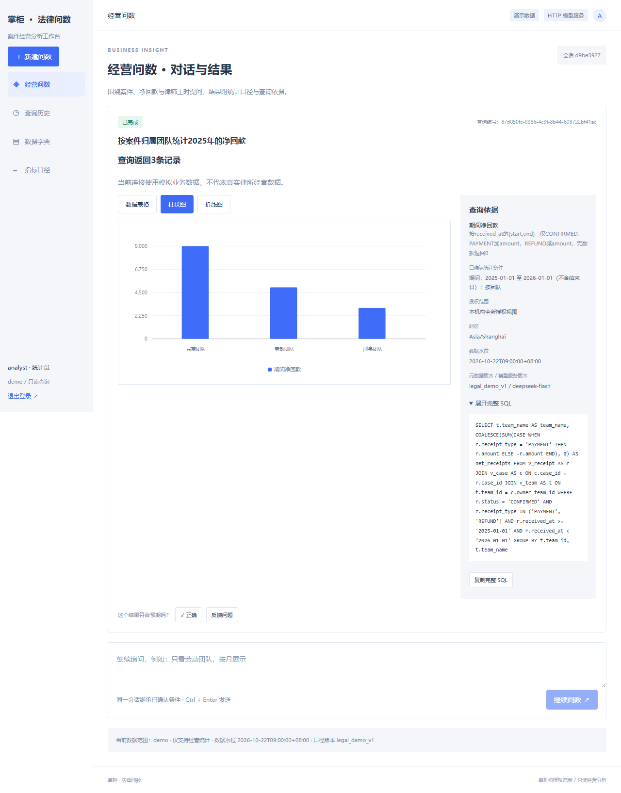

# 法律经营问数｜6组·陈海兵

面向律所与企业法务主管的案件、净回款、律师工作量问数项目。技术栈为Vue 3、FastAPI单体、MySQL 8，通过ModelClient接入DeepSeek或兼容协议的微调模型。

- [提交说明与初始化启动命令](提交说明.md)
- [代码与项目运行说明](代码文件/README.md)
- [模块级概要设计](代码文件/交付方案/03_模块级概要设计.md)
- [测试截图说明](测试截图/截图说明.md)
- [真实DeepSeek验收记录与限制](代码文件/docs/DeepSeek真实模型验收报告.md)

## 交付内容

代码文件包含前后端源码、测试、数据库初始化脚本、模拟元数据与微调种子、设计文档及pen原型。测试截图目录包含7张已有测试原图，明确区分真实模型、历史规则模拟模型及API夹具。

不包含已安装依赖、实际密钥、真实.env、数据库或运行日志；依赖声明和锁文件保留，安装后运行。所有业务样例数据均为模拟数据。

## 已记录的验证状态

2026-10-23：真实DeepSeek与真实MySQL模拟业务样例17/17通过；后端基础回归135通过、11项数据库测试跳过；前端11通过且构建通过。这些是历史验证记录，非本次上传重新运行的验收。

本项目尚未完成专用微调。完整浏览器及环境稳定性验收尚未通过，开发机曾发生Docker/WSL失联；请勿将小样本验证视为生产验收通过。

## 界面预览

真实DeepSeek生成SQL、MySQL执行模拟业务数据的团队净回款结果：

## 文件核对

文件清单.csv记录除自身和Git元数据之外的交付文件、字节数与SHA256。提交文件夹原名为“6组＊陈海兵＊问数＊法律”；因Windows不支持半角星号，使用全角＊作为分隔。
