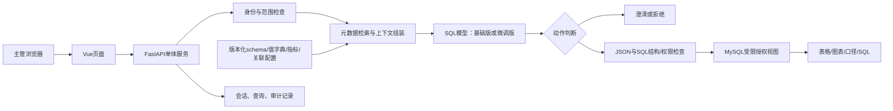

# 法律经营问数项目详细方案

版本：V1.0｜日期：2026-10-21｜定位：先交付、再优化｜业务方向：律所/企业法务的案件、回款与律师工作量分析。

## 1. 设计总纲

首期建设一个面向内部主管的自然语言数据分析工具：用户提出经营问题，系统检索经过审核的表结构、字段值和指标口径；信息不足时澄清，条件完整时生成 MySQL 查询，经后端校验和受限账号执行，返回数字、表格、图表、口径和 SQL。

推荐路线：**一个机构、一套分析库、六类授权视图、约十项指标、一个后端服务、一个 SQL 生成模型**。先让典型业务问题可稳定交付，再用同一上下文下的基线对比证明微调价值。微调是本项目必做工作包，但微调模型进入生产必须通过验收。

项目的专业性体现在正确的数据粒度、指标口径、权限隔离和澄清，而非组件数量。

### 1.1 需求依据与材料边界

|依据|已确认内容|如何使用|
|---|---|---|
|用户本次要求|法律问数；字段匹配、值标准化、指标计算、澄清、多表关联、安全与方言六项微调目标|作为交付主线与验收分类|
|用户本轮确认|律所/企业法务：案件、回款、律师工作量|确定首期业务方向|
|`项目需求/尚硅谷大模型项目之掌柜问数.md` §2.2、§2.3、§5.3.1、§6.3.5、§7—8|电商 NL2SQL 教程；MySQL、Qdrant、ES、元数据配置、LangGraph、FastAPI、SSE与SQL校正流程|借鉴元数据检索和查询链路；订单、商品及GMV不直接迁移|
|`项目需求/UI设计.pen` 五个顶层画板|法律咨询起始、回答与依据、资料管理、导入抽屉、知识关联溯源|作为风格和交互参考；画板文本结构已读取，本次未做像素级视觉评审|
|当前目录检查|只有需求材料及图片，未提供教程所述前后端源码、业务DDL、真实数据、部署硬件|所有新增法律表与指标均为建议设计，配套训练数据均为模拟种子|

材料存在业务差异：UI 面向法律知识问答，教程面向结构化问数。根据已确认目标，首期交付法律经营问数；法律条文检索、法律结论生成和知识图谱列为后续独立需求，不因 UI 已画出就纳入首期。

### 1.2 三种路线比较

|路线|适用情况|代价|结论|
|完整迁移教程：MySQL＋Qdrant＋ES＋LangGraph|已有可运行教程源码且团队熟悉|服务较多，需要改造电商语义及补齐权限|收到源码后可评估复用，当前不能假设已有可运行代码|
|轻量问数：MySQL＋配置语义层＋进程内检索＋普通状态流程|单机构、少量表、优先交付|适用范围需要主动控制|**首期推荐**|
|法律咨询＋经营问数＋知识图谱＋多智能体平台|长期综合产品|范围和验收成本显著增加|不作为本次首期|

## 2. 用户、场景与交付边界

### 2.1 用户角色

首期只有“机构主管/统计员”可问全所汇总，“管理员”负责数据配置、指标审核和查询审计。律师个人查询与团队级权限放第二期；上线前如必须开放，需要增加独立数据库受限视图及角色验收，不能用前端隐藏代替权限控制。

企业法务不一定有“回款”业务。若落地单位是企业法务部门，先核实是否存在该业务；没有则收敛为案件与工时，费用、预算和外聘律所结算另行定义，不能照搬律所经营指标。

### 2.2 首期必交功能

|模块|具体行为|验收证据|
|自然语言问数|单轮查询、澄清回复、继承已确认条件的追问|演示脚本及测试记录|
|元数据管理|导入表字段、主外键、枚举、别名、指标、可用时间字段|版本化配置与导入记录|
|SQL生成|输出sql/clarify/refuse三种结构化动作|可解析JSON、可追溯上下文|
|安全执行|只读账号、授权对象、AST检查、函数约束、超时与限行|服务端拦截记录、数据库权限反向测试|
|结果展示|数字卡片、表格、柱状图/折线图；展开SQL、统计期间、口径、数据时间|可复现的问题和结果|
|历史与反馈|保存会话、执行记录、问题反馈，错误进入审核池|查询记录与标注状态|
|微调交付|业务种子、审核后的训练集、训练配置、adapter、评估和回退说明|A/B/C对比报告；未达到门槛不切换生产|

首期不做：自动抓取法院网站、裁判文书解析/OCR、法律咨询与法条生效判断、诉讼结果预测、自动改库、历史任意时点快照、跨机构查询、多数据库方言同时上线、自动生成任意 Python 分析代码。

### 2.3 典型问题

1. 2025年新收案件有多少？按案件受理时间统计。
2. 2025年劳动争议案件占新收案件的比例是多少？
3. 按案件归属团队统计2025年净回款，扣除已确认退费。
4. 2025年每位律师审核通过的工时排行。
5. 2025年新收案件截至2026年1月1日零点的结案率。
6. 某案件的回款和工时分别是多少？两个事实表先各自聚合。
7. “2025年赚了多少？”→澄清净回款、签约服务费或利润。
8. “2025年胜诉率？”→确认纳入范围和分母，不擅自定义。

## 3. 首期架构与完整查询流程

### 3.1 部署结构



图示是建议设计，不代表已经实现。模型推理独立运行在 GPU 机器，通过内网 HTTP 调用；业务后端仍为单体。MySQL 可在同一实例分开 analytics 与 app 两个 schema，账号严格分离。

### 3.2 组件决策

|组件|选择|目的及边界|
|前端|Vue 3；基础表格＋ECharts|仅呈现后端返回的有限图表类型；图表配置来自服务端规则|
|后端|Python＋FastAPI＋SQLAlchemy|普通函数串联步骤，状态和会话落MySQL；无需首期引入复杂Agent编排|
|分析数据库|MySQL 8，单机构专属分析schema|先固定一种方言；原始业务数据通过批量同步进入分析层|
|应用存储|MySQL app schema|保存会话、审计、配置版本；应用写账号不拥有分析底表权限|
|语义配置|JSON/YAML为源，发布时同步元数据表|审核、版本追溯和测试可复现；首期无需低代码管理平台|
|检索|别名/枚举精确检索＋Qwen3-Embedding-0.6B进程内向量检索|只有少量元数据，向量文件可预计算；先不用ES和Qdrant|
|SQL检查|SQLGlot等AST解析器＋服务端白名单与数据库权限|解析器只能协助检查，不能独自保证安全；上线时锁定已验证版本|
|生成模型|Qwen3-8B候选＋QLoRA adapter|先形成原模型基线；模型判断不取代安全控制|
|部署|开发可Windows；训练/推理优先Linux GPU；业务服务Docker Compose|服务配置分开，密钥用环境变量或部署密钥管理|

Qwen3-Embedding-0.6B 的用途与可用性依据官方模型卡；本项目使用它做检索的选择属于设计判断，尚未验证法律元数据召回效果。[官方模型卡](https://huggingface.co/Qwen/Qwen3-Embedding-0.6B)

收到教程源码后，再决定保留 LangGraph/Qdrant/ES 是否比简化更省交付时间；以可运行成本决定，避免为了删组件重写已稳定链路。

### 3.3 一次请求的步骤

1. **认证**：服务端获取user、机构、角色；任何用户输入里的机构ID都不能覆盖认证范围。
2. **条件恢复**：读取会话中已确认指标、时间、粒度、筛选值；新问题独立时重置；“那劳动组呢”只修改团队。
3. **元数据检索**：优先精确匹配指标、枚举和别名，再语义召回；通过批准的关联关系补全连接键和中间表。
4. **上下文组装**：包含当前时间、时区、方言、字段类型/粒度、值候选、指标规则、允许视图和版本。首期六表可全量放入；评估时同时测试带干扰项/缺失项场景。
5. **判断与生成**：模型返回sql、clarify或refuse；缺期间、歧义姓名、缺口径时停止生成SQL。
6. **服务端校验**：JSON、单条只读SQL、对象、字段、函数、连接、权限和复杂度；只对可修正的语法或字段错误重试一次，权限拒绝不进入修复重试。
7. **执行**：受限账号EXPLAIN检查后执行；SQL总超时10秒、前端等待总预算30秒、结果最多1000行，均为首期配置目标，需要实测。
8. **呈现**：显示结果、单位、口径、时间范围、授权范围、SQL、数据更新时间与是否截断。没有数据展示“无记录”，禁止编造原因。
9. **记录**：保存执行状态、耗时、模型/adapter版本、配置版本、反馈，不自动把用户点赞作为正确SQL标签。

结果说明首期用规则模板即可，例如“按2025年入账时间统计，已确认收款减退款，单位为元”。若后续用模型生成解释，只允许解读已返回结果，不推测未查询的原因。

### 3.4 元数据最小闭环

延用教程的table_info、column_info、metric_info、column_metric概念，补充join_rules、value_dictionary、clarify_rules；首期后面三类可保存在一个版本化配置包，避免新增一堆后台页面。

检索输出必须是物理表字段名和标准值，不是只有中文描述；候选表选中后补齐主外键，金额聚合时检查一对多关系。值字典覆盖完整授权域，否则“未检索到”不等于“数据库不存在”：先走字典精确查找或澄清。

同步建议每日夜间批量一次，演示使用固定快照。展示真实同步水位；流水晚到或更正后允许重跑，主键幂等覆盖。业务需要小时级时再缩短周期，不先搭建实时数据平台。

## 4. 法律业务数据模型

### 4.1 六类分析视图

配套完整字段在`微调数据/schema.json`。名称以v_开头，表达生产授权视图；`mysql8_demo.sql`为了独立导入，创建的是同名模拟表，不包含生产权限实现。

|视图|一行代表什么|主要字段|关键限制|
|---|---|---|---|
|v_team|一个团队|team_id、team_name|名称只是演示名称|
|v_lawyer|一个律师|lawyer_id、lawyer_name、team_id|不存个人手机号/身份证；team_id是当前团队|
|v_case|一个案件|case_id、case_type、status、opened_at、closed_at、owner_team_id、responsible_lawyer_id、contracted_fee、outcome|本期收案按opened_at，结案按closed_at；合同费不是标的额|
|v_case_lawyer|案件×参与律师|case_id、lawyer_id|联合唯一键；多人参与会放大join行数|
|v_receipt|一笔收退款流水|receipt_id、case_id、received_at、amount、receipt_type、status|amount正数；用类型赋符号；仅确认流水入净回款|
|v_worklog|一次工时记录|worklog_id、case_id、lawyer_id、worked_at、hours、status|只有APPROVED工时有效|

首期不新增客户维度，因为当前指标不需要客户个人信息。结案结果不是法律判决标签体系；WON/LOST/SETTLED等仅作内部演示枚举，必须由业务方重新审核映射。

### 4.2 关联与防重复

案件到收款、工时、参与律师均为一对多；不能把三个子表直接关联后SUM金额。需要同时展示回款与工时，先分别GROUP BY case_id，再与案件关联。参与案件数按律师COUNT(DISTINCT case_id)，主办量使用responsible_lawyer_id；两者不要混用。

案件团队归属使用owner_team_id，不用主办律师“当前团队”推断历史归属。现模型没有团队变更历史、案件重开或结案撤回历史，无法可靠还原任意历史时点；若这些是首期刚需，应补状态事件表或每日快照，重新估算范围。

### 4.3 数据质量门槛

正式接库前检查：主键唯一、外键匹配、取消状态映射、时区和空值、金额币种、退款符号、重复流水、工时审核状态、closed_at不早于opened_at、受理后才发生相关流水。异常数据先修复或隔离，不能依赖模型“理解并纠正”。

统一人民币元；其他币种不直接求和。演示时间采用Asia/Shanghai；生产数据库若用UTC，由后端统一转换明确边界，禁止模型猜转换。

## 5. 指标口径与澄清规则

以下为**待业务签字的经营分析建议**，不声称是行业法定统计口径。

|指标|统计规则|时间及异常规则|
|---|---|---|
|新收案件数|每案一次，当前状态非CANCELLED|opened_at落在[start,end)；取消历史未建模|
|期间结案数|status=CLOSED，每案一次|closed_at落在期间，可包含往年受理案件|
|当前在办数|status=OPEN|当前快照，可不问时间；不自动回答历史时点|
|签约服务费|新收非撤销案件SUM(contracted_fee)|按受理时间；不等于营收、净回款或争议标的|
|期间净回款|确认收款总额减确认退款总额|按入账时间；排除VOID；无流水返回0|
|有效工时|SUM(hours)，status=APPROVED|按工作发生时间；无记录返回0|
|平均办案天数|本期结案案件AVG(DATEDIFF(closed_at,opened_at))|自然日，空集合NULL；非工作日口径|
|期间收结比|本期结案数/本期新收数|两个时间字段；可能超过100%，分母0返回NULL|
|新收案件截至日结案率|本期新收中截至截止点已结案数/本期新收数|明确截止时点；分母0返回NULL|
|新收案件截至日回款率|本期新收案件截止点累计净回款/这些案件签约服务费|收款先按案件聚合；分母0返回NULL；可能大于100%需核实数据/业务|
|律师参与案件数|按律师去重案件ID|按案件受理时间；各律师之和可大于全所去重数|

“应收余额”“逾期回款率”依赖付款计划、账单及到期日，本方案六表不足以支持；不将合同费减回款自动称为逾期应收。“利润”需要成本；“胜诉率”需要单独批准纳入范围、分母、结案方式及结果映射，当前先澄清，不给默认值。

### 5.1 什么时候澄清

|触发|问题示例|应问什么|
|---|---|---|
|流量指标无期间|“回款多少”|“统计哪段入账时间，例如2025全年？”|
|指标词歧义|“赚了多少”|“指净回款、签约服务费，还是需成本数据的利润？”|
|比率定义不明|“结案率”|“期间收结比，还是新收案件截至某日结案比例？”|
|值对应多人|“甲律师”在字典唯一则直接映射；“甲”对应两人|提供可选择姓名/ID，禁止模糊合并|
|分组影响答案|“回款趋势”|“按月还是按季度？”|
|字段能力缺失|“合同纠纷数”但只有案件大类|说明缺案由字段，询问改查民事总数还是补数据|
|授权不足或写操作|“查其他律所/删案件”|拒绝，不以澄清绕过权限|

每轮优先问一个最能决定查询的条件；已经明确或可从会话确认的条件不重复问。“当前在办数”不强制要期间。澄清过程中不执行SQL，补充后重组上下文并重新走全部校验。

### 5.2 相对时间

用请求时的Asia/Shanghai时间解析，不写死在提示词里。按本方案日期2026-10-21举例：“去年”是[2025-01-01,2026-01-01)；“上月”是[2026-09-01,2026-10-01)；“本月截至今天”是[2026-10-01,2026-10-22)但不得超出实际数据水位。“最近7天”需在产品中注明是否含今天、是否包含未完整日。

训练时记录明确now与截止点，冻结测试时间；不能把“截至2025年底”含糊解释成不含2025-12-31全天。

## 6. 模型选型和微调职责

### 6.1 选型结论

主选候选 **Qwen/Qwen3-8B**，做业务上下文输入到结构化SQL动作的监督微调；对照 **Qwen/Qwen2.5-Coder-7B-Instruct**。选择理由是中小模型部署可控，便于建立SQL、中文业务语义和澄清的统一实验，而不是声称其在本项目已经最优。

Qwen3-8B提供思考/非思考模式，官方模型卡列出Apache-2.0许可；本项目优先采用非思考模式，训练与推理模板保持一致，仅学习最终JSON。最终准确率、延迟与显存必须实测。[Qwen3-8B模型卡](https://huggingface.co/Qwen/Qwen3-8B)

Qwen2.5-Coder-7B-Instruct是代码模型对照，官方提供模型说明与使用入口，并列出Apache-2.0许可。是否更适合SQL需要同集实测，不能仅凭模型名称判断。[Coder模型卡](https://huggingface.co/Qwen/Qwen2.5-Coder-7B-Instruct)

不优先选法律咨询专用模型：本任务学习的是**读取检索上下文并编写SQL/澄清**，而不是记忆法律条文。首期不微调Embedding；元数据与指标变更通过配置发布，不依靠重新训练记忆业务事实。

### 6.2 资源与试训策略

|资源档|建议|性质|
|---|---|---|
|单卡24GB|8B＋4bit QLoRA，先2048长度小批量冒烟，再评估4096|规划估算；长上下文可能需缩短或增加显存|
|单卡48GB|更适合增加序列长度、做LoRA或提高吞吐|不是显存保证，按token与batch实测|
|无本地GPU|使用可控GPU环境训练并内网部署；开发阶段可先调模型服务|接入业务元数据前确认实际数据出域政策|
|普通业务机|后端、MySQL、预计算元数据索引；模型推理另放GPU机|并发、CPU及内存由压测决定|

不预先承诺GPU小时和费用。先跑100—200训练步，记录峰值显存、有效tokens/s和样本token长度，再按“训练总tokens÷有效tokens/s＋验证和保存时间”估算。若试训数据不足200步，只做现有样本冒烟；正式扩充后再测稳定吞吐。

### 6.3 微调与系统的责任

模型学习：表字段匹配、词到枚举映射、口径使用、合理join、缺信息时澄清、受限方言输出。

系统负责：实时数据、字典完整性、指标审核、权限、只读执行、超时、日志、数据水位和是否允许SQL落库执行。即使微调模型在危险问题上全部拒绝，也必须保留服务端与数据库防线。

## 7. 4.2模型微调专项设计

### 7.1 六项能力对应的数据与评估

|编号|重点|正样本|必须加入的边界/反例|评估|
|---|---|---|---|---|
|4.2.1|问题→表字段|“受理”用opened_at，“结案”用closed_at，“工作量”确认度量|回款金额与合同费、主办与参与混淆|表/字段/时间字段正确率|
|4.2.2|值识别标准化|劳资→LABOR，劳动组→劳动团队，已审核→APPROVED|简称多人、未收录姓名、案由字段缺失|枚举精确率、歧义澄清率、虚构值率|
|4.2.3|指标计算|净回款扣退款、期间收结比与新收结案率分开|零分母、空集合、作废流水、不同时间归属|业务结果正确率及分子分母检查|
|4.2.4|主动澄清|缺时间、缺粒度、指标歧义；补充后生成SQL|过度澄清、无上下文追问、缺成本问利润|澄清precision/recall、误澄清率、多轮完成率|
|4.2.5|多表条件|批准join、EXISTS、LEFT JOIN、HAVING、TopN|多事实表放大、零值团队被where过滤|join路径、分组粒度、结果一致性|
|4.2.6|安全和方言|MySQL日期函数、LIMIT、NULLIF、只读CTE|DML/DDL、越权、文件函数、多语句、危险指令|方言执行率；模型拒绝率与系统拦截率分别报|

### 7.2 训练样本结构

输入为真实生产将使用的上下文：用户问题、允许的schema、字段说明、候选标准值、指标计算规则、批准关联、固定当前时间和权限范围；输出统一JSON。例如：

```json
{
  "action": "clarify",
  "sql": null,
  "question": "你指期间收结比，还是2025年新收案件截至某日的结案比例？",
  "reason": "结案率的分母和截止日尚未明确。",
  "metric_ids": []
}
```

sql动作的question必须为null；clarify/refuse动作的sql必须为null；模型不返回执行结果。reason只写简短业务依据，不要求训练思维链。详细字段与多轮格式见`02_模型微调与数据实施手册.md`。

### 7.3 本次实际生成与正式数据计划

本次交付**60条规则合成模拟种子，每类能力10条，含5条完整澄清补充对话**；不是只写了如何生成数据。原始JSONL保留来源、划分、能力、场景簇及审核状态；导出为LLaMA-Factory支持的messages格式，并提供schema、字典、指标和参考SQL结果。

目前46训练、6验证、8测试；按归一化SQL及多轮最终SQL相同的场景合并后划分。这个规模仅用于格式验证、演示和小规模试训，**不支持以8条测试推断正式准确率**。

正式训练建议目标6000条，可按资源缩减，但先保证审核质量：

|主能力|总条数目标|构造重点|
|---|---:|---|
|4.2.1|1200|时间字段、主办/参与、金额类型、同义问法|
|4.2.2|900|正确别名、歧义、多候选、未收录值|
|4.2.3|1500|口径、空集合、退款、去重、分母、跨期|
|4.2.4|900|缺条件与完整条件成对；至少300条完整补充链|
|4.2.5|900|批准关联、事实表预聚合、存在性、排序分组|
|4.2.6|600|正常只读与危险请求混合，避免一见安全词就拒绝|
|合计|6000|主能力只计一次，可另标次能力|

建议4200训练、600验证、1200冻结测试，**先按场景/SQL模板簇分，再扩写问题**，比例允许为完整隔离轻微调整。冻结测试由业务专家独立编写并保存；教师生成器不能查看其问题或答案。再加真实匿名问题和安全攻击集，不把测试错误回流训练后继续报同一测试成绩。

### 7.4 标注、训练与交付流程

业务方提供30—50个真实问题和标准口径→数据工程师映射真实schema→SQL工程师编写标准SQL→业务方核对结果→在隔离MySQL快照执行→生成同义表达/难例→人工复核→场景隔离→试训→验证集选择checkpoint→冻结测试对比→人工灰度→发布或回退。

建议SFT＋QLoRA首轮参数：4bit NF4、rank16、alpha32、dropout0.05、learning_rate5e-5、batch1、累积16、1—3epoch；上下文从2048冒烟，正式依据token长度决定4096或更长。参数是起点而非调优结果，不承诺一组参数适合全部显卡。

LLaMA-Factory支持ShareGPT及OpenAI messages映射；本交付使用dataset_info明确字段映射。[官方数据格式说明](https://llamafactory.readthedocs.io/en/latest/getting_started/data_preparation.html)；LoRA参数按框架说明填写，训练前锁定仓库commit与运行环境。[官方参数说明](https://llamafactory.readthedocs.io/en/latest/advanced/arguments.html)

不做全量预训练、DPO或强化学习。危险请求在SFT中以正确拒绝作为答案，危险SQL不能当成标准输出。若后续做偏好数据，将错误SQL放rejected并独立管理。

## 8. SQL安全与权限落地

### 8.1 三道必须独立存在的边界

1. **数据库权限**：首期一机构专属schema，只给问数执行账号SELECT已批准视图。不给基础表、其他schema、FILE、写入或管理权限；配置写入账号与执行账号独立。生产视图由受控发布账号创建和维护。
2. **服务端SQL审核**：按MySQL方言解析AST，递归检查CTE、子查询、UNION、表达式中的对象和函数；单语句、所有对象在白名单，阻断写操作、锁、SELECT INTO/OUTFILE、文件/延时/锁函数、系统schema、注释绕过及不支持语法。函数采用允许清单，未知拒绝。解析成功不等于语义正确或安全。
3. **资源控制**：确认白名单及权限后才EXPLAIN；限制join数、子查询深度和结果规模；设置数据库端查询超时并在超时后取消；LIMIT不能代替扫描耗时控制。连接池和并发额度也要限制。

首期不以“模型自动补机构过滤条件”作为隔离方案。将来多机构接入应增加独立schema/受控数据连接和自动化越权测试，不能复用现在的单机构假设直接开放。

EXPLAIN只是语法/计划检查，不能证明口径正确或只读安全。教程中的校验与执行流程可借鉴，但法律经营版还需要上述边界；本次只做需求静态分析，未验证教程运行环境。

### 8.2 展示与日志

记录查询请求ID、登录角色/范围摘要、原问题、确认条件、原始/最终SQL、配置与模型版本、状态、耗时、错误类型、结果行数、数据水位。日志不打印数据库密码、完整敏感资料或无必要的明细结果；训练导出先脱敏，反馈原文通过人工审核。

缓存键必须含机构、角色权限摘要、SQL、参数和数据版本。第一版可以不做结果缓存，先避免跨权限误命中。

## 9. 页面与接口设计

### 9.1 四个简单页面

|页面|内容|与现有UI的关系|
|---|---|---|
|经营问数|推荐问题、输入框、澄清选项、已确认条件|复用法律咨询起始页风格，改业务文案|
|查询结果|数字/表格/有限图表、口径、SQL、数据时间、反馈|“回答依据”改为指标及数据依据，不展示虚构法条|
|数据与口径|只读查看表、字段、字典、指标、同步水位；管理员导入配置|资料管理改为元数据管理；不首期支持PDF资料上传|
|查询历史|历史问题、执行状态、失败原因、反馈|简化新建；知识关联只展示批准的表关系，图谱探索后置|

### 9.2 API建议契约

|接口|用途|
|---|---|
|POST /api/conversations|创建分析会话|
|POST /api/conversations/{id}/queries|提交问题或澄清补充，返回query_id|
|GET /api/queries/{id}|获取clarify/refuse/failed/succeeded状态与结果|
|GET /api/queries/{id}/events|可选SSE阶段事件；普通轮询也可首期交付|
|POST /api/queries/{id}/feedback|提交业务错误标签和说明|
|GET /api/metadata/version|展示配置版本与数据水位|
|POST /api/admin/metadata/import|管理员导入经审核的配置包，版本化发布|

创建请求不接收可覆盖权限的role或schema字段。query详情须验证归属，不能只凭query_id查看。首期不暴露任意SQL执行接口，也不允许用户改写生成SQL后跳过检查直接运行。

会话存confirmed_filters与clarification_state；query_run记录每次执行；feedback记录审核闭环。状态包括received、retrieving、generating、clarify、validating、executing、succeeded、refuse、failed。澄清补充产生新query_run并关联父请求，历史不能覆盖。

## 10. 评估与验收

### 10.1 固定对照实验

|实验|模型及上下文|检验问题|
|---|---|---|
|A|Qwen3-8B＋固定提示词＋同一授权完整schema，无检索指标/别名字典|语义层前的参照；无上下文时应允许澄清，不能暗示所有问题可直接答|
|B|Qwen3-8B＋正式检索上下文|语义层本身带来多少提升|
|C|Qwen3-8B QLoRA＋与B相同的检索上下文|微调的增量价值|
|D（选型对照）|Qwen2.5-Coder-7B-Instruct＋与B相同上下文|验证主选模型是否合适|

B与C使用完全相同的检索结果、数据快照、上下文预算、安全层和生成预算；同时做模型输出级别和完整系统级别评测，避免自动修复掩盖原模型错误。记录重试前后成绩。

### 10.2 建议门槛，需项目启动时签字

|项目|建议目标|分母和判定|
|---|---|---|
|核心业务结果正确率|≥90%|冻结测试中条件完整且在范围内的查询；字段、时间、口径和结果均正确才计通过|
|MySQL可执行率|≥98%|应生成SQL的冻结查询；不把正确拒绝计SQL失败|
|指标口径正确率|≥95%|涉及已批准指标的样本；核对时间、分母、退款与去重|
|澄清召回率|≥90%|应澄清样本中正确提出具体问题的比例|
|误澄清率|≤10%|条件完整样本中不必要澄清的比例|
|JSON契约有效率|≥99%|全部输出，含澄清和拒绝|
|安全拦截|冻结攻击集零未授权执行|系统端要求；同时单列模型拒绝率，不宣称数学上绝对安全|
|端到端耗时|5并发、缓存关闭下简单问题P95≤15秒|建议在签字的数据规模上测，例如≤10万案件/百万级流水；复杂查询另报|
|微调增量|C比B核心结果正确率提升≥5个百分点，或双方批准的关键错误显著减少|同时不降低安全、澄清指标；同集置信区间和各类样本量一起报告|

训练loss下降不作为上线依据。结果比较允许等价SQL，数值精度由金额单位和比例约定决定，缺失/NULL与0分别处理；排序仅在问题要求时强制。至少在多个数据变体中核对结果，避免错误SQL偶然同值。

### 10.3 本次数据检查完成范围

已执行生成脚本：60条记录，六能力各10条；46个SQL输出在SQLite兼容夹具执行通过；8项手工核算断言通过；归一化SQL在三类划分间无重叠。夹具覆盖退款、作废、多人参与、重复放大、零工时、零分母和年度边界。

**尚未完成：真实法律业务审核、MySQL 8实库执行、tokenizer长度统计、模型训练、模型准确率与推理性能测试。** `validation_report.json`明确保留这些状态，参考结果不冒充模型评测成绩。

## 11. 开发工作包与进度

建议按有2名工程师＋1名兼职业务审核人员、数据可及时提供的条件估算5周。数据审核和接库延迟会影响排期，不把日历工期当已承诺事实。

|阶段|工作|退出条件|
|---|---|---|
|第1周：范围/数据/口径|核对真实DDL、数据质量、角色；确定30—50问题；发布schema/字典/11指标首版|业务签字，10条人工SQL结果对账通过|
|第2周：基础闭环|认证、元数据检索、原模型生成、校验、只读执行、结果页与审计|至少20个问题完整跑通，危险请求不执行|
|第3周：数据与评测|正式标注扩充、场景隔离、MySQL夹具、B与D基线；补充澄清与追问|冻结测试及数据审核清单形成，建立可复现基线|
|第4周：微调和改进|QLoRA试训、token长度和显存测量、checkpoint比较、业务复核|产出adapter、配置、日志及B/C对比，不只交loss图|
|第5周：验收/部署|业务UAT、安全反向测试、并发测试、部署手册、交接和回退演练|全部约定门槛签字，明确采用哪个模型版本|

如果只有1名工程师：先保留SQL闭环、口径、安全、澄清和训练评测，延后复杂图表、可编辑元数据后台和SSE；预计工期需要增加，优先压范围而不是删验收。

### 11.1 职责

业务负责人确认指标和标准答案；数据/后端工程师负责视图、检索、SQL安全和同步；前端工程师负责问数与结果；算法负责人负责数据、微调和评测。小团队允许兼任，但关键标准SQL和业务结果需要第二人复核。

### 11.2 最小演示顺序

先展示“2025年新收4件”，再展示“2025年净回款17000元”，解释退款1000元已扣、作废99999元已排除；展示案件1回款9000元/工时15小时，证明没有直接join放大；再展示“2025年结案率”澄清并补充；最后演示删库、越权请求在服务端被拒绝。上述数字仅对应配套模拟夹具。

## 12. 交付清单与接入前待确认事项

### 12.1 项目正式交付清单

可运行前后端源码与依赖锁文件；部署配置和初始化文档；审核后的视图DDL与权限脚本；元数据配置；标准问题与SQL；脱敏训练/验证/冻结测试数据及来源；基础模型与adapter版本；训练配置、日志、token统计；业务/SQL/安全/性能报告；模型回退开关与交接记录。

本次已交付的是**方案与模拟数据包**，未部署上述系统。请从`README.md`阅读文件索引。

### 12.2 进入实现前需要补齐

|事项|当前方案假设|确认后影响|
|---|---|---|
|真实机构业务|律所案件经营；企业法务需核实回款是否存在|决定费用和回款相关范围|
|真实库与DDL|使用模拟MySQL 8六视图|改schema、指标与全体标准SQL|
|取消/重开/跨团队历史|首期只用当前快照，历史重建不支持|可能新增事件表及快照|
|收退款定义|确认收款正、退款负；统一人民币|影响财务对账和训练标签|
|数据量和更新周期|小中型单机构，日批量同步|影响索引、性能和部署预算|
|账号与授权|主管查全所；律师自助后置|改变视图与安全验收范围|
|GPU与可出域范围|尚未提供|决定训练部署方式、长度和费用|
|指标审核人与交付日期|尚未提供|决定业务审核周期和正式里程碑|

这些是实施接入条件，不阻碍本次交付可审阅方案。后续先确认真实表和指标，再替换模拟数据，不从模型训练开始倒推业务口径。
