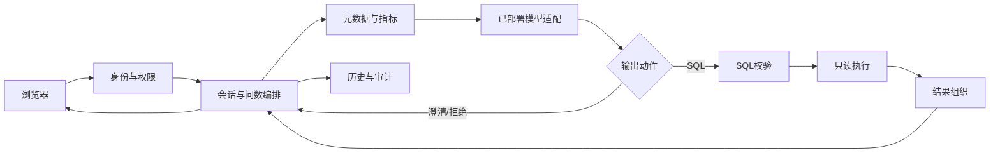

# 法律经营问数：模块级概要设计

版本：V1.1｜日期：2026-10-21｜对应原方案：`01_法律问数项目详细方案.md`

## 1. 本轮设计结论与调整

在原方案上细化模块，不扩展业务范围。首期面向机构主管/统计员查询案件、回款、律师工时；管理员维护元数据、查看运行记录和连接状态。产品保持一个前端、一个后端、一套MySQL分析视图，加一个已经部署的SQL模型服务。

**微调模型在项目外训练和部署；项目内只做模型服务接入。** 不开发训练任务、数据标注、GPU调度、模型仓库、adapter上传、在线微调和多模型自动路由。之前交付的微调数据与训练手册作为独立准备资料保留，本轮应用模块和开发排期不包含训练平台。

接入时推荐让模型服务用相同名称`legal-sql-v1`提供能力。无论服务内部是基础模型、合并后的微调模型，还是基础权重加载adapter，应用层均只提交messages并接收最终JSON。模型服务内部装载方式由部署方负责。

原方案的统计口径、六类分析视图和SQL安全边界继续有效；本文件与其存在粒度差异时，以本文件的模块划分、接口和本轮范围为准。**这是概要设计和低保真原型，以下类、接口、数据表均为待实现建议，不表示已有系统代码。**

## 2. 模块结构

划分为八个逻辑模块，均在同一FastAPI进程内组织；模块不是八个微服务，也不要求每个模块都有独立管理页面。

|编号|模块|主要职责|输入|输出|建议实现位置|
|---|---|---|---|---|---|
|M01|身份与权限|认证用户、识别角色、限定会话与数据范围|登录凭证、请求|AuthContext|dependencies/auth.py、services/auth_service.py|
|M02|会话与问数编排|保存问题、恢复已确认条件、串联整条查询链|问题、conversation_id|QueryResponse|services/query_service.py、conversation_service.py|
|M03|元数据与指标|schema、字典、关联、指标、时间上下文组装|问题、条件、授权范围|QueryContext|services/metadata_service.py|
|M04|模型适配|调用已部署模型，校验输出契约|QueryContext、对话|ModelDecision|clients/model_client.py|
|M05|SQL校验|只读、对象字段、函数、结构与资源约束|SQL、授权范围|ValidatedQuery或拒绝原因|services/sql_guard.py|
|M06|查询执行|受限账号EXPLAIN和执行、限时限行|ValidatedQuery|QueryResult|repositories/analytics_repository.py|
|M07|结果组织|数字、表格、图表、SQL及口径展示信息|查询结果与指标|ResultView|services/result_service.py|
|M08|历史、审计与轻管理|保存运行记录、反馈；配置导入与连接检查|执行轨迹、管理员操作|历史列表、运行详情、配置状态|services/history_service.py、admin_service.py|

M02是唯一业务流程入口。M04不能直接连接数据库；M06不接受前端或模型未经校验的SQL；M07不能自行编SQL或再次调用模型；M08不能绕过M01访问任意用户记录。



## 3. 核心数据对象

所有对象先使用普通Pydantic模型/字典表达，不引入事件总线和复杂Agent状态框架。

|对象|主要字段|说明|
|---|---|---|
|AuthContext|user_id、role、organization_id、scope_id|由后端认证生成，不能由请求体覆盖|
|ConfirmedConditions|metric_ids、time_range、time_field、group_by、filters、as_of|只保存用户已确认或规则唯一确定的条件|
|QueryContext|question、history、confirmed_conditions、schema、value_candidates、metrics、join_rules、now、timezone、dialect、metadata_version、scope_id|M03输出；不得混入标准答案和执行结果|
|ModelDecision|action、sql、question、reason、metric_ids|与已交付微调数据的输出格式一致|
|ValidatedQuery|sql、allowed_objects、metric_ids、scope_id、metadata_version|仅M05构造，M06仍验证账号和连接范围|
|QueryResult|columns、rows、row_count、truncated、data_watermark、elapsed_ms|金额以十进制字符串传输，NULL保持null|
|ResultView|summary、table、chart、basis、sql、warnings|M07生成；图表引用同一份查询数据|

### 3.1 模型输出契约

```json
{
  "action": "sql",
  "sql": "SELECT COUNT(*) AS open_cases FROM v_case WHERE status='OPEN'",
  "question": null,
  "reason": "当前在办按OPEN状态统计。",
  "metric_ids": ["open_cases"]
}
```

|action|sql|question|下一步|
|---|---|---|---|
|sql|非空SQL|null|M05校验|
|clarify|null|非空的具体问题|保存待澄清状态，返回UI-02|
|refuse|null|null|保存拒绝原因，停止执行|

reason必须有可理解说明；metric_ids必须属于批准指标集合，可为空。模型动作和界面文案不可代替服务端权限判断。

## 4. M01 身份与权限模块

### 4.1 处理职责

首期用简单内部账号登录，不开发注册、租户开通和复杂组织树。两个角色：analyst（主管/统计员）和admin（管理员）；均只属于当前专属机构，admin不等于数据库超级用户。

如果接入单位已有登录网关，可将认证替换为已有身份，不改变下游AuthContext。独立部署无网关时，用预置账号、密码哈希和有过期时间的会话cookie；不在前端保存明文密码。登录页采用普通账号密码表单，本次九张核心业务界面不单列登录画板。

### 4.2 权限矩阵

|功能|analyst|admin|
|---|---|---|
|发起全所问数|允许|允许|
|自己的查询历史和结果|允许|允许|
|查看已发布字段/指标说明|只读|允许|
|导入元数据配置|不允许|允许|
|查看全所运行记录|不允许|允许|
|查看连接状态、测试模型连接|不允许|允许|
|修改业务数据、查其他机构|不允许|不允许|

服务端对每个conversation_id和query_id核对归属；运行记录管理员接口单独鉴权。隐藏导航只是界面表现，不能取代API鉴权。

### 4.3 数据隔离

首期机构使用专属分析schema，问数账号只有批准视图的SELECT权限。scope_id映射为后端固定连接和对象白名单；不接受用户上传DSN，不让模型选择数据源，也不让模型通过补where条件承担机构隔离。

## 5. M02 会话与问数编排模块

### 5.1 最小业务流程

1. 验证会话归属；保存query_run并生成query_id。
2. 读取已确认条件及待澄清问题。
3. 调用M03生成完整上下文。
4. 调用M04得到三种动作之一。
5. clarify/refuse直接保存并返回；sql调用M05。
6. 校验通过后调用M06，再由M07组织结果。
7. 无论成功、澄清、拒绝或失败，都调用M08记录最终状态。

首期使用普通异步HTTP请求完成整条链，**不引入后台任务队列**。前端提交后显示“正在生成查询/查询中”，收到最终响应切换页面；服务器内部阶段保存在query_run，管理员可追踪。SSE作为后续增强，不阻塞首期。

### 5.2 会话继承规则

|输入|处理|
|---|---|
|新建问数|创建新会话，无继承条件|
|“2025年净回款按团队统计”|记录指标、入账时间、团队维度|
|紧接着“只看劳动团队，按月展示”|继承2025年与净回款，团队过滤改为劳动团队，分组改为月份|
|澄清后回复“期间收结比”|继承2025年，确认口径；生成新query_run并关联原澄清记录|
|无历史时说“那劳动团队呢”|问清指标和时间，不能猜测|
|明显新问题或用户点击“新建问数”|不沿用无关筛选；有疑问先澄清|

不只依靠自然语言摘要保存条件。ConfirmedConditions是结构化值；更新时记录本轮覆盖的字段，避免旧团队、旧时间悄悄污染新查询。模型辅助识别后，由后端验证字段、值及指标是否存在。

### 5.3 重复提交与超时

前端按钮在请求进行时禁用，并提交client_request_id；数据库以(user_id, client_request_id)唯一约束防止相同请求重复执行。相同ID重试返回原query_id及已保存状态，不另起执行；原请求仍执行时返回“处理中”。每个会话同一时间只允许一个新请求，避免两次追问并发改写条件。

原请求仍处理时，重复提交返回HTTP 202及`{query_id, status:"processing", stage}`。前端仅在这种重试/断线恢复场景下每秒调用一次已有GET查询接口，收到clarify、refuse、succeeded或failed即停止；最多等待35秒，之后提示查看历史，禁止自动重发产生新执行。首次正常提交仍同步等待最终响应。若请求取消或进程中断，尽量在清理逻辑记录失败；过期processing记录在服务启动或读取时按deadline_at转failed，不能长期卡住会话，也不能自动重新执行。

单请求总预算30秒，查询执行预算最多10秒；模型调用、最多一次修复共享剩余预算，不是各自无限重试。权限拒绝、危险操作、缺信息不重试。超时先取消执行，再记录failed与可理解错误，不能让前端超时而数据库继续无界执行。

## 6. M03 元数据与指标模块

### 6.1 管理内容

元数据包统一包含六类视图字段、粒度、标准值及别名、批准关联、11项指标定义、时间字段和澄清规则；使用当前交付的schema.json、value_dictionary.json、metrics.json作为演示起点。

首期一个版本包即可，不建设逐字段在线编辑审批系统。配置文件版本化，管理员上传后先校验，成功才切换当前版本；上一个版本保留用于问题追踪和回退。

### 6.2 检索与组装

六表规模下先全量提供授权schema，优先用精确字典/别名和指标名称匹配；进程内向量召回作为可选增强，暂不依赖ES、Qdrant或Reranker。传入模型前补全关联键、指标依赖列与表粒度。

后端用明确的Asia/Shanghai请求时间解析“去年/上月”；与schema、字典一起传入。不同指标对应不同时间字段，不能把用户所有“2025年”统一套在案件受理时间上。

字典未命中时先在完整授权值域精确核实；值域仍不完整则说明“当前信息未匹配”，不得断言数据库不存在。出现多个候选姓名时提供可选择项。元数据版本缺失或指标未批准时停止生成，不凭模型记忆补字段。

### 6.3 发布校验

检查对象与字段真实存在、指标引用列有效、关联键存在、标准值重复与别名歧义、数据类型、时间字段、版本号。失败返回具体路径，例如`metrics.net_receipts.relevant_columns`，不覆盖当前配置。发布日志记录操作者和版本。

本模块不导入裁判文书、法条和PDF；数据字典不是法律文档知识库。

## 7. M04 模型服务适配模块

### 7.1 只保留一个客户端

应用使用一个ModelClient，提供方法`generate(context, messages) -> ModelDecision`。HTTP调用封装在此处，编排、页面和SQL执行模块不依赖Qwen模型内部细节。

推荐接入已部署的Chat Completions兼容HTTP服务：发送model与messages，读取返回的最终assistant content并解析为ModelDecision；若部署服务采用自定义协议，只在ModelClient转换。模型并非任意HTTP地址配置后就能自动兼容，需要部署方满足同一请求、响应及非思考模式约定。

### 7.2 最小配置

```dotenv
MODEL_BASE_URL=https://model.internal/v1
MODEL_NAME=legal-sql-v1
MODEL_API_KEY=<由部署环境注入>
MODEL_TIMEOUT_SECONDS=12
```

这里只是占位示例，不是真实可访问服务，也不包含任何密钥。模型底座及adapter版本由部署方记录；应用至少保存MODEL_NAME及服务版本标识。Qwen3服务应在部署/模板侧设置非思考模式；不要把这项配置暴露给普通用户。

### 7.3 接入时序

应用组装问题＋schema＋标准值＋指标规则→ModelClient发送messages→模型返回最终JSON→JSON契约校验→输出ModelDecision→统一SQL校验。

不要求应用下载权重、识别LoRA rank或加载adapter文件。初期可接基础版服务，微调版验收后由部署配置切换服务或同名模型版本；切换后仍跑固定问题、澄清和安全回归。

### 7.4 异常处理

网络断开、服务超时、输出缺字段、JSON损坏与不支持动作分别记录错误码。格式错误或可修复的语法/字段错误，整条流程合计最多允许一次重新生成；输入修复提示只包含必要错误和授权schema，不能回传密钥或其他机构信息。

UI显示“模型服务暂不可用，请稍后重试”，不要把服务器堆栈直接展示给普通用户。连接检查使用不含业务数据的小型契约样例，并检查返回JSON格式，不以“HTTP 200”单独判断业务接入成功。

## 8. M05 SQL校验模块

### 8.1 处理顺序

先校验ModelDecision，再按MySQL方言解析SQL AST；检查单语句及只读性质；递归检查CTE、子查询、UNION中的对象、列和函数；检查批准关联及聚合粒度；再检查复杂度限制。

禁止DML/DDL、SELECT INTO/OUTFILE、锁语句、文件/延时/外部访问函数、系统schema和未批准对象。函数使用允许清单，首期只纳入实际指标需要的聚合、CASE、COALESCE、NULLIF、日期与数值函数；未知语法失败关闭。

六表的主要业务规则需要显式检查：收退款符号、CONFIRMED/APPROVED过滤、指标时间字段、参与案件去重、多事实表预聚合。通用AST检查不能证明任意SQL满足业务口径；首期对已支持指标建立规则和标准SQL回归，未覆盖场景先澄清或拒绝。

### 8.2 输入输出

输入：sql、metric_ids、scope_id、metadata_version；输出：ValidatedQuery。失败返回错误码与中文说明，如`SQL_NOT_READ_ONLY`、`SQL_OBJECT_DENIED`、`SQL_FIELD_INVALID`、`SQL_METRIC_RULE_MISMATCH`。

可修复错误回到M04一次；危险及越权错误直接refuse，不把攻击原文交给“自动修复”反复尝试。

## 9. M06 只读查询执行模块

使用独立连接池和只读账号，接受ValidatedQuery且再次确认scope_id对应当前固定连接；配置写账号不进入此连接池。EXPLAIN必须在安全校验之后执行，不用EXPLAIN代替安全审查。

执行超时10秒、结果最多1000行并有响应字节上限；需要判断截断时允许读取第1001行作为标记，再只返回1000行。LIMIT不能控制扫描量，仍需数据库端超时、并发限额和必要索引。

查询结果金额按decimal处理，JSON序列化为字符串；比例允许NULL，不把NULL替换为0；数据更新时间读取同步水位而不是“本次查询时间”。返回truncated提示，避免用户把前1000行误认为完整数据。

需要索引的主要列：案件受理/结案时间和团队外键、回款入账时间及case_id、工时发生时间及lawyer_id/case_id、参与关系联合主键。具体复合索引通过真实EXPLAIN和数据规模决定，不在概要设计中盲目建立所有组合。

数据同步作为每日脚本/已有ETL任务完成，首期不开发通用数据集成平台。数据库不可用、执行超时、字段漂移分别记录；字段漂移使本次查询失败，并提示管理员检查配置版本。

## 10. M07 结果组织模块

只使用M06返回数据组织结果，不再次请求模型生成SQL；首期使用规则生成结论，避免模型杜撰业务原因。

|结果形态|展示规则|
|---|---|
|单数值|数字卡片＋单位＋时间＋口径|
|维度/数值两列|默认表格，可切柱状图；时间维度可切折线图|
|复杂多列表格|只展示表格，不强行推断图表|
|空集合|显示“该条件下无记录”，口径要求总额0的按0展示|
|比例分母0|显示“暂无可计算比例”，保留NULL，不显示0%|
|超过返回限制|显示截断提示，建议缩小时间或增加筛选|
|有未确认指标|显示澄清，不能展示估计数字|

统一结果依据包含完整SQL、物理时间字段、实际查询期间、指标口径、授权范围、元数据版本和数据水位。UI-04右栏用摘要占位，实际应用中支持展开完整SQL和复制；不把SQL摘要当成可执行代码。

反馈只做“正确/反馈问题”；错误类型可选字段、筛选、口径、结果、其他。反馈进入待审核记录，不直接修改模型或配置。图表切换在前端使用同一份数据，不产生新模型调用。

## 11. M08 历史、审计与轻管理模块

### 11.1 用户历史与管理员记录区分

用户历史面向“继续上次的问题”，显示问题、时间、状态、已确认条件和结果。管理员运行记录面向“为什么失败”，显示query_id、执行阶段、耗时、校验错误、SQL、元数据与模型服务版本。

历史重跑产生新的query_run，原记录不覆盖。旧结果保留原查询口径与水位；重新查询用当前数据，应明确标注变化。管理员可看授权机构记录，普通用户只能看自己的记录。

### 11.2 首期管理能力

只做配置包导入、当前元数据/指标查看、模型连接测试、同步水位/超时/行数上限展示。系统配置页展示部署配置和状态，不做任意URL在线保存、任意SQL编辑或访问凭证回显。

模型参数由部署环境维护；页面的“测试连接”只是管理员触发检查。元数据导入则通过API真正发布配置版本，两者不要混同。

## 12. 应用数据库概要

业务分析仍用原方案六视图；应用另用app schema，首期五张应用表即可。表字段先按需求落地，不为未来平台设计大量扩展表。

|表|主要字段|用途及约束|
|---|---|---|
|app_user|id、username、password_hash、role、organization_id、enabled|预置用户，username唯一；可被已有认证替换|
|conversation|id、user_id、title、confirmed_conditions_json、pending_clarification_json、active_query_id、created_at、updated_at|保存会话状态；同会话只处理一个新请求|
|query_run|id、conversation_id、user_id、client_request_id、parent_query_id、question、status、stage、decision_json、sql、result_json、metadata_version、model_service_version、scope_id、data_watermark、elapsed_ms、error_code、created_at、deadline_at、finished_at|完整运行记录；(user_id,client_request_id)唯一；SQL/结果按权限访问|
|query_feedback|id、query_id、user_id、feedback_type、comment、review_status、created_at|用户反馈与人工审核状态|
|metadata_version|id、version、config_path、checksum、status、published_by、published_at|配置包文件与版本追溯；仅一个active版本|

query_run.result_json只保存受限大小结果，建议上限1MB；超限不完整保存时记录`result_snapshot_available=false`并提示“历史结果未留存，可重新查询”，不静默截成完整快照。日志只记录必要摘要，不打印密钥和无必要明细。保留期限由交付单位确定并配置清理任务。

不单建聊天消息表：首期通过query_run的问题、clarify动作及parent_query_id恢复对话。也不单建细粒度事件表；stage、状态与耗时足够首期排障，后续有需求再扩展。

## 13. 接口概要

接口均要求身份验证；管理员接口额外检查role。以下仅为设计约定，不是已运行API。

|方法与路径|权限|用途|主要响应|
|---|---|---|---|
|POST /api/auth/login|未登录可用|内部账号登录|用户信息＋会话cookie|
|POST /api/auth/logout|登录|退出会话|退出状态|
|GET /api/me|登录|获取身份和允许导航|user、role、scope|
|POST /api/conversations|登录|新建问数|conversation_id|
|POST /api/conversations/{id}/queries|会话归属用户|提交问题/澄清补充，普通请求等待最终结果|query_id、status、decision或result|
|GET /api/queries/{id}|本人或管理员|获取单次查询详情/已有执行状态|QueryResponse|
|GET /api/conversations|本人|历史会话列表|列表与分页|
|GET /api/conversations/{id}/queries|本人|恢复会话及查询列表|确认条件、查询记录|
|POST /api/queries/{id}/feedback|本人|提交反馈|feedback_id|
|GET /api/metadata|登录|当前批准字段、字典、指标|元数据版本与说明|
|POST /api/admin/metadata/import|管理员|校验并发布配置包|版本或校验错误|
|GET /api/admin/query-runs|管理员|查询运行记录|列表与分页|
|GET /api/admin/system/status|管理员|显示脱敏连接配置、水位和限制|状态信息，不返回凭证|
|POST /api/admin/model/test|管理员|小样例连接及契约检查|连接/契约通过与否|

### 13.1 提交与返回示例

请求：

```json
{
  "client_request_id": "example-unique-request-id",
  "question": "2025年结案率是多少？"
}
```

澄清响应：

```json
{
  "query_id": "q_demo_002",
  "conversation_id": "c_demo_001",
  "status": "clarify",
  "decision": {
    "action": "clarify",
    "sql": null,
    "question": "你要看期间收结比，还是新收案件截至指定日期的结案率？",
    "reason": "需要确认分母和截止点。",
    "metric_ids": []
  },
  "confirmed_conditions": {
    "time_range": {"start": "2025-01-01T00:00:00+08:00", "end": "2026-01-01T00:00:00+08:00"}
  }
}
```

正常成功响应包含`result.summary/table/chart/basis/sql`，SQL及结果仅对授权用户可见。澄清和内容级拒绝是正常业务响应；未认证401、无接口权限403、请求格式错误422、服务不可用503、执行/模型超时504。超时响应尽量带query_id，便于用户查看已保存失败状态，禁止泄露内部异常栈。

同ID重复提交仍在执行时返回202及processing对象，按5.3恢复查询状态；GET读取成功返回200，响应中的status决定是否进入终态。截止点或时间字段尚未确认时保持空，不从上述2025时间范围猜测按受理、结案还是入账时间统计。

## 14. 状态和错误设计

query_run.status只用：processing、clarify、refuse、succeeded、failed。处理中细分stage：received、retrieving、generating、validating、executing、formatting。最终状态只写一次；澄清后的新请求另建记录，不把旧clarify改成succeeded。

|场景|用户看到|后端记录|允许的操作|
|---|---|---|---|
|正在处理|按钮禁用，显示当前处理提示|processing＋stage|等待；重复请求返回原记录|
|缺统计条件|具体问题和可选口径|clarify|补充条件|
|查询无记录|无记录＋已用筛选|succeeded，空rows|修改条件继续问|
|模型不可用|模型服务暂不可用|failed，MODEL_UNAVAILABLE|稍后重试|
|只读/权限拒绝|当前问数不支持该操作|refuse，SQL_NOT_READ_ONLY/SQL_OBJECT_DENIED|重新描述统计问题|
|数据库超时|本次查询超时，请缩小范围|failed，QUERY_TIMEOUT|缩小范围后新查|
|字段漂移|数据配置已变化，需管理员检查|failed，SCHEMA_CHANGED|管理员更新配置|
|图表不适合|保留表格|succeeded，不生成chart|查看数据表格|

低保真用UI-02展示澄清，UI-05展示待澄清/拒绝/失败的入口，UI-08展示失败原因。加载、空结果和错误作为这些页面的就地状态，不增加独立页面和复杂流程。

## 15. UI页面与模块映射

设计文件：`法律问数_低保真UI.pen`；包含1个九宫格总览和9个1280×820独立画板。沿用用户截图的浅灰背景、白色内容、细边框、窄左导航和蓝色按钮，实际内容是法律经营问数，不照搬参考图的订单、退款和人工客服业务。

|编号|页面/状态|主要内容|关键动作|对应模块|
|---|---|---|---|---|
|UI-01|经营问数首页|输入框、案件/回款/工时推荐问题、水位|开始问数|M01、M02、M03、M04|
|UI-02|条件澄清|原问题、口径选项、已确认条件|确认并继续|M02、M03、M04|
|UI-03|查询结果·表格|数字卡、分组数据、单位、口径、反馈、追问|查看图表、继续追问|M05、M06、M07、M08|
|UI-04|图表与查询依据|团队柱状图、指标规则、SQL摘要与完整SQL入口|切表格、复制SQL|M07|
|UI-05|查询历史|问题列表、时间、完成/澄清/拒绝/失败|查看或继续|M02、M08|
|UI-06|数据字典|表目录、字段、含义、样例、关联|管理员导入配置包|M03、M08|
|UI-07|指标口径|指标目录、公式、时间、退款和空数据规则|使用指标提问|M03|
|UI-08|查询运行记录|请求列表、阶段、耗时、错误、版本|查看SQL与口径|M01、M08|
|UI-09|系统配置|已有模型服务、连接状态、同步水位、查询限制|测试连接|M04、M08|

UI-06/07画板显示管理视角，普通用户可用只读版本且隐藏导入按钮；UI-08/09只对管理员显示。首页等普通用户画板已隐藏运行记录和系统配置导航。九宫格中的5个用户状态和4个管理页面是设计展示分组，实际前端可复用问数、结果和配置布局，不需要开发9套独立应用。

### 15.1 交互路径

UI-01输入问题→条件不全进UI-02→补充后进UI-03→同结果切UI-04；UI-03追问沿用确认条件。UI-05可以恢复原会话。管理员在UI-06发布字典及指标配置，在UI-07核对指标，在UI-08定位错误，在UI-09确认模型服务接入。

图表页和表格页是同一结果页的两个状态；低保真没有接后端、按钮点击或可运行SQL能力。“已连接”“已批准”和金额均为演示状态，不能视为真实连通或业务审核完成。

## 16. 建议目录与实施顺序

```text
backend/app/
  api/                  # 认证、问数、历史、元数据、管理路由
  schemas/              # 请求、上下文、模型决策和结果结构
  dependencies/auth.py  # 身份及权限依赖
  services/             # 会话编排、元数据、校验、结果、历史
  clients/model_client.py
  repositories/         # 应用存储和独立分析只读连接
  conf/metadata/        # 已发布元数据配置包
frontend/src/
  views/                # 问数、历史、数据字典、口径、运行记录、配置
  components/           # 统一导航、澄清选项、结果表格、图表、依据面板
  api/                  # 统一接口封装
```

建议先用模拟模型返回三种动作，完成UI-01→02→03及历史存储；再接真实模型服务；之后加入SQL校验与只读执行，最后补管理页面。模拟链路只能验证交互，正式演示数字必须来自真实执行结果。

工作顺序：①身份与应用表→②元数据包和10条标准SQL→③模型客户端契约→④查询编排和澄清→⑤SQL安全与执行→⑥结果/历史→⑦配置和运行记录→⑧模型替换及验收。

## 17. 模块验收要点

|模块|最小验证|
|---|---|
|M01|非本人query_id不可读取；analyst无法访问管理接口；其他schema不可查|
|M02|时间与团队追问正确继承；无历史不猜；重复请求不执行两次；澄清后记录可追溯|
|M03|字段依赖和连接键齐全；配置导入失败保留旧版本；歧义值不被静默合并|
|M04|只改部署模型配置即可接同契约微调服务；sql/clarify/refuse都可解析；断网超时可读|
|M05|写操作、未知对象、危险函数和多语句被拒绝；关键指标规则可回归|
|M06|使用受限账号；超时会取消；1000行截断有标记；退款及多事实表无重复放大|
|M07|表格图表数值一致；NULL与0区别显示；水位真实；SQL可追溯|
|M08|用户与管理员视角隔离；历史保留当时版本；不回显凭证；反馈未经审核不改口径|

模型接入专门验证：同一批冻结问题在原模型与微调服务都走同一模块链路；切换时不改schema、指标和SQL安全规则。应用只承诺协议接入，模型准确率仍按原方案的业务结果、澄清和安全测试验收。
